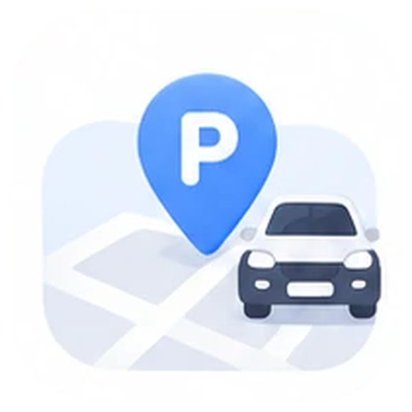

# 내 차 어딨지? (Where's My Car)

> 내 차 위치부터 예상 주차요금까지.

토스 앱 안에서 동작하는 **앱인토스 미니앱**입니다. 주차한 순간의 위치·층·구역·번호·사진을 남기고, 주차 경과 시간과 직접 입력한 요금표로 예상 요금을 확인합니다. 로그인·서버 없이 모든 기록은 기기에만 저장됩니다.



## 기능
- 주차 시작: 현재 위치(선택, 1회) · 주차장명 · 층 칩(B5~3F/기타) · 구역 · 기둥/면 번호 · 주변 사진(선택) · 메모 · 시작 시각 수정
- 타이머: 시작 시각 기준 경과 시간(앱을 닫아도 이어짐), 원형 진행 표시
- 요금표: 무료 시간 · 기본 시간/요금 · 추가 단위/요금 · 1회 최대 요금 → **예상 요금**(실제 정산 금액과 다를 수 있음 표기). 주차장 이름으로 저장해 재사용
- 주차 종료: 총 시간·예상 요금 요약, 실제 정산 금액 직접 기록(선택)
- 기록(전체/진행 중/완료, 최근 50개) · 검색(주차장/층·구역/메모, 최근 검색어) · 통계
- 지도에서 보기(카카오맵 링크) · 좌표 복사
- 설정: 요금표 관리 · 앱 정보 · 이용약관 · 개인정보 처리방침 · 오픈소스 라이선스 · 고객센터 · 모든 기록 삭제

## 개발
```bash
npm ci
npm run dev        # 브라우저 미리보기 (http://localhost:5173)
npm test           # 단위 테스트(vitest)
npm run typecheck
npm run build      # 라이선스 목록 생성 + 타입 검사 + vite build
npm run build:ait  # 앱인토스 업로드 번들(whereiscar.ait)
npm run icons      # 시안 이미지에서 아이콘을 잘라 콘솔 로고·앱 로고·파비콘·OG 생성(Pillow)
```

구조
```
apps-in-toss.config.ts   appName·권한·내비게이션 바
src/domain/              순수 로직(요금 계산·시간·기록 상태) — 테스트 대상
src/storage/             Storage 어댑터·상태 JSON 읽기/쓰기(방어적 파싱)
src/platform/            토스 SDK 호출(위치·카메라·지도·복사)·사진 압축
src/state/store.tsx      앱 상태 컨텍스트(저장 실패 시 되돌림)
src/screens/             화면 11개
src/components/          아이콘·일러스트·공통 UI·토스트/확인창
tests/                   단위 테스트
docs/                    DECISIONS · RELEASE_CHECKLIST · 시안 · 원본 기획
```

출시 절차는 [docs/RELEASE_CHECKLIST.md](docs/RELEASE_CHECKLIST.md), 설계 결정은 [docs/DECISIONS.md](docs/DECISIONS.md).

## 검증 상태

| 기능 | 구현 | 자동 테스트 | 브라우저 확인 | 샌드박스 | 토스 iOS | 토스 Android |
|---|---|---|---|---|---|---|
| 주차 저장(수동 입력) | ✅ | ✅ | ✅ | ⬜ | ⬜ | ⬜ |
| 위치 1회 조회·거부 시 수동 | ✅ | ⬜(SDK) | ⬜(브라우저 권한 미실행) | ⬜ | ⬜ | ⬜ |
| Storage 재진입 복원 | ✅ | ✅(메모리 저장소) | ✅(새로고침) | ⬜ | ⬜ | ⬜ |
| 타이머(startedAt 기준) | ✅ | ✅ | ✅ | ⬜ | ⬜ | ⬜ |
| 예상 요금 계산 | ✅ | ✅(경계값) | ✅ | ⬜ | ⬜ | ⬜ |
| 주차 종료·실제 금액 | ✅ | ✅ | ✅ | ⬜ | ⬜ | ⬜ |
| 사진 촬영·저장 | ✅ | ⬜ | ⬜ | ⬜ | ⬜ | ⬜ |
| 지도 열기·좌표 복사 | ✅ | ⬜ | ⬜ | ⬜ | ⬜ | ⬜ |
| 기록·검색·통계·설정 | ✅ | ✅(로직) | ✅ | ⬜ | ⬜ | ⬜ |

## 개인정보·비용
- 위치·사진·기록은 기기(토스 미니앱 저장소)에만 저장하고 외부로 보내지 않습니다. 지도 버튼을 누를 때만 좌표가 담긴 카카오맵 링크가 열립니다.
- 서버·유료 API 없음. 앱인토스 파트너 등록·운영 조건은 별도입니다.
- 결제 기능 없음. 예상 요금은 실제 청구 금액이 아닙니다.

## 작업 내역 (Work Log)

### 2026-11-08 — 첫 구현
- 파킹로그 기획(`docs/SUPER_PROMPT.md`)을 **내 차 어딨지?**로 이름 변경해 구현. 사용자 시안(`docs/design/reference.webp`)의 아이콘·화면 구성(시작·홈·주차 기록·검색·타이머·요금표·기록 목록·설정)을 재현. 시안과 다른 점은 DECISIONS D-005~D-008.
- 점심합의(lunchagree) 앱인토스 구조(SDK 3.x config, `platform/toss.ts`, `storage/kv.ts`, 해시 라우팅, 라이선스 생성 스크립트)를 따름.
- 프롬프트 대비 바꾼 점: 기록 보관 5→50개, 문서 16종→3종으로 압축, 시안 반영을 위한 탭바·검색·통계 추가(D-003, D-010, D-018).
- 실행한 명령과 결과
  - `npm test` → 4개 파일 **35개 테스트 통과**(요금 경계값 70분 2,000원·75분 2,500원, 최대 요금, 0원/잘못된 요금표, 시계 역행, 보관 한도·사진 정리, 손상 JSON 복구, 이 앱 키만 삭제)
  - `npm run typecheck` 통과, `npm run build` 통과, `npm run build:ait` → `whereiscar.ait` 생성(약 198KB)
  - 브라우저 미리보기(데스크톱 Chrome 엔진): 시작→홈→주차 저장→타이머→요금표(2시간 35분 → 예상 5,000원)→새로고침 후 복원→종료(실제 4,500원)→검색·통계·설정 확인, 콘솔 오류 없음
- **미실행**: 앱인토스 샌드박스, 토스 iOS/Android 실기기(위치·카메라·Storage·openURL 실제 동작, 사진 재진입 지속성), 콘솔 등록. 데이터 외부 전송 없음.

### 2026-11-08 — 앱 아이콘 교체·콘솔 등록
- 앱 아이콘을 사용자 시안 왼쪽 위 아이콘에서 그대로 잘라 교체(`scripts/build-app-icons.py`, D-017). 직접 그린 SVG 아이콘과 resvg 의존성 제거.
- 앱인토스 콘솔(워크스페이스 '오늘의상한가')에 `whereiscar` 앱 생성, 번들·기본 정보·카테고리(자동차>주차)·로고·키워드·주요 기능 입력 후 임시저장. 확인 항목 체크·검토 요청은 소유자 결정 대기.
